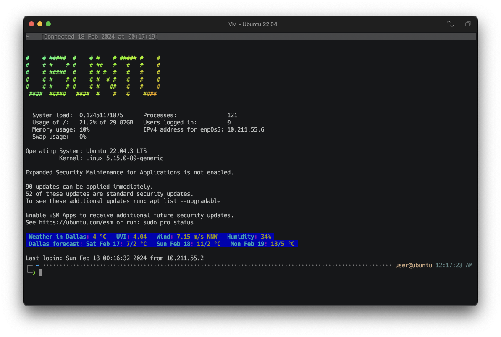

# gh-motd

A simple script to set up an awesome MOTD. It includes:
* lolcat (https://github.com/busyloop/lolcat)
* figlet (https://github.com/cmatsuoka/figlet)

## Demo

Currently, the command prompt looks like this:

## Installation

``` bash
sudo curl -fsSL https://raw.githubusercontent.com/gustavohellwig/gh-motd/main/gh-motd.sh | bash
```
